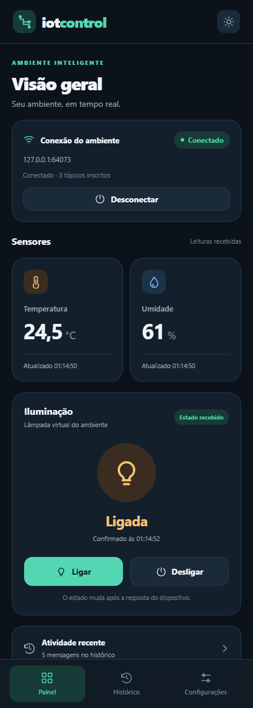
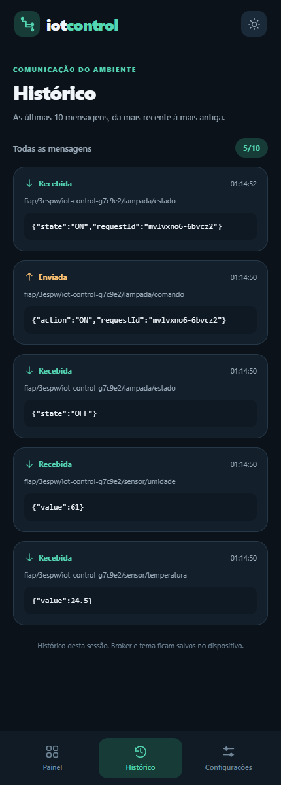
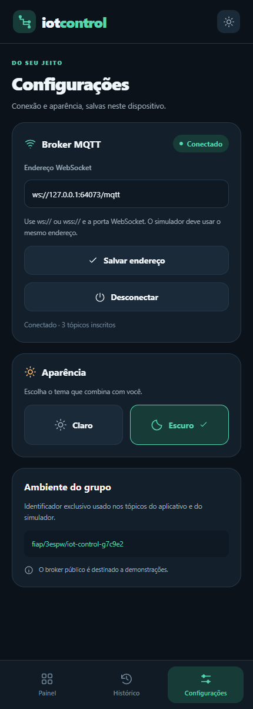
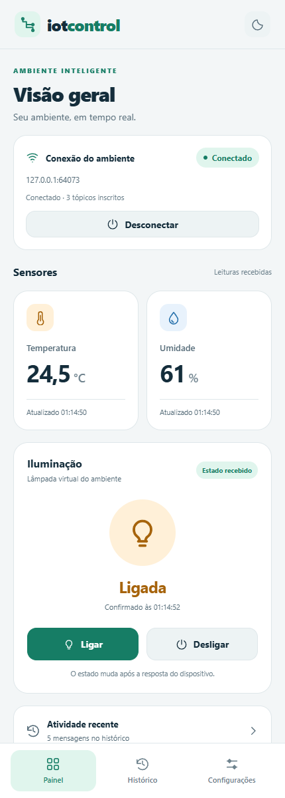
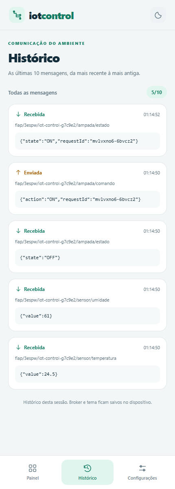
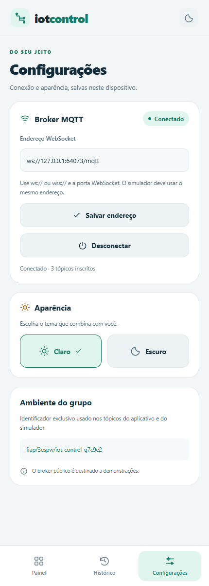

# IoT Control — Checkpoint 3

Aplicativo de **Mobile Development & IoT** em React Native, Expo e TypeScript. Monitora temperatura e umidade em tempo real e controla uma lâmpada virtual por **MQTT 3.1.1 sobre WebSocket**. Um segundo cliente, executado em Node.js, representa o dispositivo: recebe comandos e publica o estado confirmado.

**Turma: 3ESPW — FIAP.**

## Integrantes

| Nome completo | RM |
|---|---|
| Arthur Silva | RM553320 |
| Eduardo Escudero | RM556527 |
| Leonardo Prado | RM556824 |
| Davi Vieira | RM556798 |
| Luca Monteiro | RM556906 |

## Telas e funcionalidades

**Painel:** conexão, leituras com horário, estado confirmado da lâmpada e controles Ligar/Desligar. O toque envia um comando; somente uma mensagem recebida no tópico de estado altera a lâmpada exibida. Se não houver resposta em seis segundos, o aplicativo avisa e conserva o último estado recebido.

**Histórico:** as dez mensagens mais recentes da sessão, em ordem decrescente, com tópico completo, conteúdo, horário local e direção. Mensagens inválidas são identificadas e não substituem os valores dos sensores.

**Configurações:** URL WebSocket, conexão/desconexão e tema Claro/Escuro. URL e tema são salvos com AsyncStorage e recuperados ao reiniciar. Alterar e salvar o broker encerra a conexão anterior para evitar que as leituras apareçam associadas ao endereço errado.

Capturas reais da versão Web do aplicativo em viewport de 430 × 1200, conectada ao broker local e ao simulador incluídos. A porta aleatória dos prints pertence ao teste automatizado; para executar manualmente, use a porta **9001**.

| Painel — Dark | Histórico — Dark | Configurações — Dark |
|---|---|---|
|  |  |  |

| Painel — Light | Histórico — Light | Configurações — Light |
|---|---|---|
|  |  |  |

## Tecnologias e versões

Versões instaladas e registradas no `package-lock.json`:

| Tecnologia | Versão | Uso |
|---|---|---|
| Node.js | 24.22.1 na validação; mínimo 22.13 | Ferramentas e simulador |
| Expo | 58.0.19 | Execução Android, iOS e Web |
| React / React DOM | 19.3.0 | Interface e suporte Web |
| React Native | 0.88.0 | Aplicativo mobile |
| React Native Web | 0.21.4 | Mesma interface no navegador |
| TypeScript | 6.0.3 | Tipagem estrita |
| Eclipse Paho JavaScript | 1.1.0 | Cliente MQTT do aplicativo, usando WebSocket |
| AsyncStorage | 2.2.0 | Preferências locais |
| React Native SVG | 15.16.0 | Ícones |
| Safe Area Context | 5.10.1 | Áreas seguras Android/iOS |
| MQTT.js | 5.16.1 | Cliente do simulador e testes |
| Aedes | 1.2.0 | Broker local reproduzível |
| Vitest / Playwright | 4.1.12 / 1.64.1 | Testes de unidade e de integração pela interface |

## Instalação

Instale Node.js 24 LTS e Git. No terminal:

```sh
git clone https://github.com/duduescudero/iot-control-mqtt-cp3.git
cd iot-control-mqtt-cp3
npm ci
```

O projeto não exige conta em serviço MQTT, hardware, senhas ou arquivo `.env`.

### Opção A — demonstração com broker público

Em um terminal, execute o dispositivo simulado:

```sh
npm run simulate
```

Em outro terminal, inicie o aplicativo:

```sh
npm start
```

Abra no **Expo Go compatível com o SDK 58**, usando Android ou iOS e o QR Code apresentado. O computador e o telefone devem conseguir acessar o servidor de desenvolvimento; normalmente ficam na mesma rede Wi-Fi. Se a rede bloquear essa comunicação, use outra rede ou a opção de túnel disponibilizada pelo Expo.

Para executar no navegador, utilize `npm run web`. Para abrir um emulador Android já configurado, `npm run android`. Para o simulador iOS, execute `npm run ios` em um Mac com Xcode; no Windows, use um iPhone com Expo Go ou a versão Web.

No aplicativo, toque em **Conectar**. A configuração inicial é:

```text
wss://test.mosquitto.org:8081/mqtt
```

Essa é a porta **8081, WebSocket com TLS (WSS)**. Não é a porta MQTT TCP 1883. O simulador usa a mesma URL por padrão. Não execute simultaneamente dois simuladores para este grupo.

### Opção B — demonstração local, independente do broker público

Após `npm ci`, abra três terminais na pasta do projeto:

```sh
# Terminal 1: broker MQTT via WebSocket
npm run broker
```

```sh
# Terminal 2: dispositivo simulado no broker local
npm run simulate -- ws://localhost:9001/mqtt
```

```sh
# Terminal 3: aplicativo no navegador
npm run web
```

Em **Configurações**, informe `ws://localhost:9001/mqtt`, toque em **Salvar endereço** e depois em **Conectar**. O broker local escuta na porta **9001**, caminho **/mqtt**, via **WS**.

Para testar em um celular, substitua `localhost` no aplicativo pelo **IPv4 do computador na rede Wi-Fi**, por exemplo `ws://192.168.0.10:9001/mqtt`. Consulte o IPv4 com `ipconfig` no Windows. O exemplo de IP precisa ser substituído pelo endereço real. Mantenha os dois aparelhos na mesma rede, permita acesso à porta 9001 no firewall da rede privada e autorize rede local no iOS quando solicitado. O simulador no próprio computador pode continuar usando `localhost`.

Os arquivos de configuração permitem tráfego WS local em builds nativos próprios para esta demonstração. O Expo Go possui suas próprias políticas de rede; se o acesso local for bloqueado, utilize o broker público WSS. No navegador, uma página HTTPS não pode abrir WS inseguro: use WSS nesse cenário ou execute a demonstração local em HTTP.

## Protocolo MQTT

Prefixo exclusivo do grupo, compartilhado entre aplicativo e simulador:

```text
fiap/3espw/iot-control-g7c9e2
```

| Tópico completo | Direção no aplicativo | Payload mínimo | QoS / retain do publicador |
|---|---|---|---|
| `fiap/3espw/iot-control-g7c9e2/sensor/temperatura` | Subscribe / recebida | `{"value":24.5}` | 1 / true |
| `fiap/3espw/iot-control-g7c9e2/sensor/umidade` | Subscribe / recebida | `{"value":58}` | 1 / true |
| `fiap/3espw/iot-control-g7c9e2/lampada/comando` | Publish / enviada | `{"action":"ON"}` ou `{"action":"OFF"}` | 1 / **false** |
| `fiap/3espw/iot-control-g7c9e2/lampada/estado` | Subscribe / recebida | `{"state":"ON"}` ou `{"state":"OFF"}` | 1 / true |

O aplicativo acrescenta um `requestId` textual ao comando. O simulador o devolve na confirmação, permitindo relacionar pedido e resposta. Clientes manuais podem usar os payloads mínimos da tabela: o campo é opcional. Comandos não são retidos para evitar execução automática de um comando antigo quando um dispositivo conectar.

O simulador publica sensores a cada quatro segundos e o estado inicial `OFF`. Depois de um comando válido, espera aproximadamente 450 ms e publica o novo estado. A temperatura varia suavemente em torno de 24,5 °C e a umidade em torno de 58%; são dados sintéticos de demonstração. O estado permanece em memória enquanto esse processo estiver aberto. Leituras e estado são retidos pelo broker para um cliente recém-conectado recebê-los imediatamente. O broker local perde as mensagens retidas quando é encerrado.

São aceitos objetos JSON com números finitos: temperatura entre −50 e 100 °C e umidade entre 0 e 100%. Estados e comandos usam `ON`/`OFF` em maiúsculas. JSON inválido, tipos incorretos e valores fora da faixa geram feedback e registro no histórico. Horários mostram o momento de recebimento/publicação no aplicativo, no fuso do aparelho.

## Roteiro de avaliação sem hardware

1. Inicie broker e simulador pela opção A ou B e conecte o aplicativo ao mesmo broker.
2. Confira temperatura e umidade e aguarde a próxima atualização: os valores/horários mudam sem atualizar a tela manualmente.
3. Toque em **Ligar**. O histórico registra o comando enviado e o simulador mostra `Comando recebido: ON`.
4. Aguarde a resposta no tópico de estado. O painel passa a **Ligada**, com o horário da confirmação.
5. Toque em **Desligar** e verifique o mesmo ciclo com `OFF` e **Desligada**.
6. Abra **Histórico** e confira direção, tópico, conteúdo e horário. Após mais de dez eventos, apenas os dez últimos permanecem.
7. Troque para o tema Claro em **Configurações**, salve o broker e reinicie o aplicativo. As duas preferências permanecem. A conexão é iniciada pelo usuário após reabrir.
8. Desconecte e toque em Ligar: aparece um aviso e nenhum comando é publicado. Reconecte pelo botão da tela.
9. Para observar ausência de confirmação, encerre somente o simulador, mantenha o broker ativo e envie um comando: após seis segundos aparece o aviso, sem inventar um estado novo.

Para enviar manualmente uma leitura ou um dado inválido, mantenha o broker ativo e use, por exemplo:

```sh
node --input-type=module -e 'import mqtt from "mqtt"; const c=mqtt.connect("ws://localhost:9001/mqtt"); c.on("connect",()=>c.publish("fiap/3espw/iot-control-g7c9e2/sensor/temperatura",JSON.stringify({value:29.4}),{qos:1},()=>c.end()));'
```

Esse comando usa aspas simples externas e funciona no PowerShell moderno e em shells Unix. Troque `29.4` por `"inválido"` para verificar a rejeição. O simulador continuará publicando seus próprios valores no intervalo seguinte.

## Organização e decisões técnicas

```text
App.tsx                     navegação, cabeçalho, avisos e áreas seguras
src/components/             cartões, botões, ícones e mensagens reutilizáveis
src/screens/                Painel, Histórico e Configurações
src/context/IoTContext.tsx   estado compartilhado e ciclo de vida dos hooks
src/services/mqttService.ts conexão, subscriptions, publicação e limpeza
src/services/storageService.ts persistência e fila de gravação
src/config/mqtt.ts          broker padrão e tópicos
src/types/                  contratos TypeScript
src/themes/                 paletas Light e Dark
src/utils/                  validação e apresentação de valores
scripts/                    broker, simulador e servidor da exportação Web
tests/                      testes unitários e de integração
docs/                       prints e registro de verificação
```

Há uma instância de comunicação por provider. `useEffect` instala e remove o listener; desconectar cancela tentativas futuras, retira inscrições e fecha a conexão estabelecida. Cada tentativa possui uma geração: callbacks antigos não atualizam a interface. Em falhas, são feitas até três novas tentativas, com intervalo de três segundos, além da ação manual **Reconectar**. O estado Conectado só aparece após o broker confirmar as três inscrições. A navegação por abas usa estado React, mantendo a comunicação no provider acima das telas. Componentes usam StyleSheet, Flexbox e tipos explícitos, sem `any` no código TypeScript do projeto.

## Testes e exportação

```sh
npm run typecheck
npm test
npm run build:all
npx playwright install chromium
npm run test:e2e
```

Os testes de interface iniciam um broker local e o simulador reais; não dependem da disponibilidade do broker público. A exportação deve existir em `dist/` antes de executá-los. `npm run build:web` também atende a esse requisito. Para navegar pela exportação, execute `npm run serve` e abra `http://127.0.0.1:4173`.

O GitHub Actions executa tipagem, testes, exportação Android/iOS/Web e integração Web a cada push. Detalhes e limites da validação estão em [docs/TESTES.md](docs/TESTES.md).

## Limitações e configurações necessárias

- O broker público é compartilhado, sem autenticação e sem garantia de disponibilidade; use o broker local se necessário. O identificador do grupo evita colisões acidentais, mas não fornece privacidade. Use apenas dados de demonstração.
- Este projeto não configura autenticação MQTT. Não inclua senhas, tokens ou credenciais privadas no repositório. Para produção, seriam necessários broker autenticado, autorização por tópico e TLS obrigatório.
- URL e tema persistem; histórico, última telemetria e comando pendente são dados da sessão. Mensagens retidas podem representar um estado anterior; o horário mostrado é o recebimento, não a medição original do dispositivo.
- Ao desconectar, o painel mantém as últimas leituras com seus horários e mostra a conexão encerrada. Ao trocar de broker, limpa as leituras para não misturar ambientes.
- Sistemas móveis podem suspender a conexão em segundo plano. A demonstração deve ocorrer com o aplicativo aberto; ao retornar, confira o status e utilize Reconectar quando necessário.
- A interface e a comunicação foram testadas automaticamente na Web. Os bundles Android e iOS foram gerados com sucesso; não foi realizada validação em telefone físico nem distribuição de APK/IPA. Para compilação nativa local, utilize o ambiente Android/iOS exigido pelo Expo.

## Entrega

Enviar **somente o link deste repositório GitHub** na tarefa do Microsoft Teams. O repositório contém código, simulador, instruções e prints; o enunciado não solicita vídeo, apresentação, PDF ou ZIP para esta atividade.

## Referências

- [Enunciado do professor — Checkpoint 3](https://github.com/anderltda/doc-react-native/blob/main/CPS/3ESPV/Segundo%20Semestre/README_TRABALHO_REACT_NATIVE_MQTT.md)
- [Documentação do Expo](https://docs.expo.dev/)
- [Eclipse Paho JavaScript](https://github.com/eclipse-paho/paho.mqtt.javascript)
- [Broker de testes Mosquitto e portas](https://test.mosquitto.org/)
- [MQTT.js](https://github.com/mqttjs/MQTT.js)
- [Aedes](https://github.com/moscajs/aedes)
